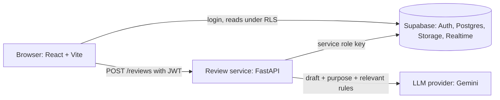
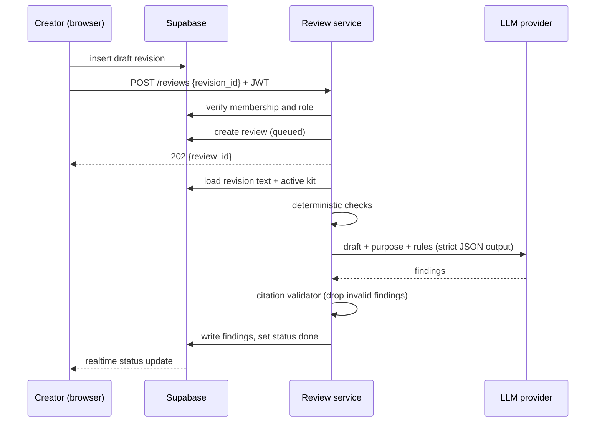

# ARCHITECTURE.md — AnchorDraft (Phase 1)

**Status:** DRAFT for review. Planning document written on 3 Nov 2026, before the Round 2 build window opens (4 Nov 10:00). It contains no application code. Decisions marked **PROPOSED** have not yet been confirmed by the architect. Items marked **VERIFY** must be checked against current documentation before they are relied on.

**Companion documents:** `DATA_MODEL.md` (Phase 2), `API_CONTRACT.md` (Phase 3), `REVIEW_ENGINE.md` (Phase 4). Still to write: build plan (Phase 5), disclosure log (Phase 6).

**Revision 2 (3 Nov 2026):** decisions 1 to 9 confirmed by the architect; decision 9 resolved in favour of database functions; decisions 10 to 12 added.

**Revision 3 (4 Nov 2026):** Decision 13 explicitly approved by the architect. Decision table is the current source of truth for status.

---

## 1. Objectives

### 1.1 Goal for the Round 2 core
One complete review-and-approval loop that never breaks. It doubles as the demo script and the acceptance test:

1. The Guideline Owner loads a sample brand kit (about 15 rules and 5 approved facts).
2. The Creator submits a draft containing 4 planted issues: a banned term, an absolute claim, an unsupported fact, and a missing alt text.
3. The system returns at least 3 findings. **Every shown finding has a valid rule or fact citation and a quote that really appears in the draft.**
4. The Creator accepts one finding, dismisses one with a reason, and a new revision is created.
5. The Manager requests changes, the Creator revises, and the Manager approves.
6. The insights page shows the dismissed rule.

### 1.2 Quality priorities (in order)
1. Citation correctness.
2. Access control and security.
3. Usability.
4. Speed. Target (ASSUMPTION): an asynchronous review of a 500-word post completes in under 30 seconds.

### 1.3 Non-goals
Direct publishing to social platforms, real-time co-editing, fine-tuned models, and all Tier 3 items.

### 1.4 Constraints
- Window: Wed 4 Nov 10:00 to Sat 7 Nov 10:00. Solo, AI-assisted development.
- Roughly 30 to 35 focused hours.
- Only in-window work is judged. AI tools, templates, reused patterns and external services must be disclosed. Judges may ask the builder to explain any part, so every design must be explainable.

## 2. System context and trust boundaries



| Component | Trust level | Responsibility |
|---|---|---|
| Web app (React) | **Untrusted** | UI only. Reads through RLS. Never calls the LLM. Never holds a service key. |
| Supabase | Enforces access | Auth, Postgres, Storage, Realtime. RLS isolates each organisation. |
| Review service (FastAPI) | Trusted | Verifies the JWT and the caller's role itself, runs reviews, is the **only writer of findings**. |
| LLM provider (Gemini) | External | Receives only the draft text, the stated purpose and the relevant rules. |
| Drafts and uploaded files | **Untrusted data** | Treated as data, never as instructions. |

## 3. Main flow: submitting a draft for review



## 4. Key decisions

| # | Decision | Reason | Risk and mitigation | Status |
|---|---|---|---|---|
| 1 | Asynchronous review: a background task plus a status field | Absorbs LLM latency and free-tier cold starts without a queue service | A restart can lose a job. Add a `failed` status, a retry button, and mark stuck reviews failed | DECIDED |
| 2 | FastAPI is the only writer of `reviews` and `findings` | Users cannot forge findings | Service key stays server-side only | DECIDED |
| 3 | The server computes text offsets from the model's quoted span | Never trust model-supplied offsets | If the quote is not found, drop the finding | DECIDED |
| 4 | Rules are data with stable keys in versioned kits | Insights survive rewording; findings stay explainable | Reviews record the kit version used | DECIDED |
| 5 | Pass the whole kit in the prompt, with a size cap | No retrieval to debug in 72 hours | Fail with a clear message if the kit is too big; retrieval is the later path | DECIDED |
| 6 | The LLM sits behind a provider adapter. Candidate providers: Gemini on the free tier, with Groq as a configured alternative; final provider selection and model identifier are determined at the provider spike (`REVIEW_ENGINE.md` section 3). | Swap models, test with a fake provider | Keep the interface tiny; handle rate limits and timeouts explicitly | DECIDED |
| 7 | Schema is delivered as SQL migration files in the repository | Reviewable and reproducible | | DECIDED |
| 8 | Deterministic findings also pass through the citation validator | One citation rule for every finding | | DECIDED |
| 9 | All workflow state changes go through atomic `SECURITY DEFINER` database functions called with Supabase RPC (not triggers); users have no direct write access to the workflow tables | Atomic, testable, cannot be bypassed from the browser | Functions must be hardened (fixed `search_path`, role checks, locked permissions); see `DATA_MODEL.md` 8.4 | DECIDED |
| 10 | The review service exposes only four endpoints: start review, import text, lint kit, health. Everything else is direct Supabase | Smallest Python surface to build, test and defend | | DECIDED |
| 11 | Partial results: if the model fails, the review still finishes with deterministic findings (`llm_status = failed`) | The demo survives a model outage or quota error | Submission is blocked until a review with a working model run exists | DECIDED |
| 12 | Decisions and applying them are separate: `record_decision`, then `apply_decisions` builds one new revision on the server | One re-review per batch (fewer model calls); the client cannot tamper with revision text | Overlapping or stale suggestions are skipped and reported | DECIDED |
| 13 | One shared citation validator runs on every candidate finding, and the review service writes results through one atomic service-only database function | A finding can only reach the database if it cites a real rule or fact and a real quote; a review is never half-written | The validator is the critical component and gets the heaviest testing (`REVIEW_ENGINE.md` section 7) | DECIDED |

**Decision 6 clarification:** The following are **decided**:
- Provider-adapter architecture (the LLM sits behind an adapter interface).
- Candidate provider strategy for the provider spike: Gemini on the free tier, with Groq as a configured alternative.

The following are **not decided** and remain subject to the provider spike (`REVIEW_ENGINE.md` section 3):
- Exact provider selection.
- Exact model identifier.
- SDK choice.
- Quota and free-tier suitability.

Decision 8 lets day 1 end with a validated, cited finding without any LLM call, as promised in the Round 1 plan.

## 5. Implementation approach

### 5.1 Repository layout
```
anchordraft/
  docs/              design documents, ai-log/
  supabase/migrations/
  engine/            app/{api,auth,pipeline,checks,llm,validator,store,models}, tests/
  web/               src/features/{auth,kits,drafts,findings,approvals,insights}, src/lib, src/components
  README.md
```

### 5.2 Principles
- Frontend: feature folders, with a service layer that takes an injected Supabase client so it can be tested.
- Engine: build and unit-test **the validator and the deterministic checks first, against a fake LLM provider.** Add the real provider afterwards.
- Every external call has a timeout and an explicit failure path.

### 5.3 Build slices (focused-hour budget)

| Slice | Work | Hours |
|---|---|---|
| 0 | Repository, docs commit, both services deployed as hello-world, Supabase project | 2 |
| 1 | Schema, auth, roles, RLS | 4 |
| 2 | Brand kit CRUD and seed data | 3 |
| 3 | Deterministic checks and validator with fake provider and tests | 4 |
| 4 | LLM adapter, prompt, end-to-end review wired to the UI | 5 |
| 5 | Triage UI (accept, edit, dismiss) and revisions | 4 |
| 6 | Approvals, comments, reviewer routing | 4 |
| 7 | Insights page and 30-post benchmark script | 3 |
| 8 | Hardening, README and disclosure, presentation | 3 |
| | **Total** | **32** |

### 5.4 Checkpoints
- End of day 1 (Thu 5 Nov 10:00): both services deployed and talking; a pasted draft returns at least one validated, cited finding.
- Middle of day 2: full loop works.
- End of day 2 (Fri 6 Nov 10:00): roles, comments, revision history complete.
- Day 3 morning: feature freeze.
- Sat 7 Nov before 07:00: submission uploaded.

### 5.5 Review-driven workflow
One branch per slice. A short pull request to self with a checklist: matches scope; I can explain it; no invented dependencies or versions; security items handled. Conventional commit messages. The first commit on 4 Nov is the approved design documents, labelled pre-window planning.

## 6. Deployment topology

| Part | Host | Notes |
|---|---|---|
| Web app | Vercel | Static build; only public keys |
| Review service | Render | Free tier cold starts: warm it before demos |
| Data, auth, files | Supabase | Managed |

**Configuration (names only; never commit values):**
- Web: `VITE_SUPABASE_URL`, `VITE_SUPABASE_ANON_KEY`, `VITE_ENGINE_URL`.
- Engine: `SUPABASE_URL`, `SUPABASE_SERVICE_ROLE_KEY`, JWT verification settings (VERIFY current Supabase approach), `LLM_PROVIDER` (`gemini` or `groq`, chosen at the provider spike), `LLM_MODEL`, the matching key (`GEMINI_API_KEY` or `GROQ_API_KEY`), `ALLOWED_ORIGINS`, `DAILY_REVIEW_CAP`.

## 7. Security boundaries (summary)
- The service role key and the LLM key exist only in the engine's environment.
- The engine re-derives the caller's organisation and role from the database. It never trusts a client-supplied `org_id` or role.
- Drafts and guideline files are data. The prompt delimits them clearly, the model has no tools, and its output must match a strict schema.
- Upload type and size limits; rate limiting and a daily review cap on the review endpoint.

## 8. Risks and cut list

| Risk | Mitigation |
|---|---|
| Two deployments in 72 hours | Deploy hello-world in Slice 0 |
| Model invents findings | Citation validator; low-confidence flag |
| Model rate limits or timeouts | Explicit failure status, retry button, deterministic checks still run |
| Free-tier cold starts | Warm-up before demos, loading state |
| Database function complexity and permissions | One negative test per function; harden every function per `DATA_MODEL.md` 8.4 |
| Re-review noise (see `DATA_MODEL.md` Q1) | Accept in Tier 1; carry decisions forward in Tier 2 |

**Cut order if behind:** Tier 3 first (model-assisted rule extraction, realtime polish, UI polish), then PDF/DOCX import, then insights polish. Never cut deployment or the demo.

## 9. Open decisions

**Remaining implementation/provider choices (subject to provider spike):**
- Exact provider selection (Gemini vs. Groq).
- Exact model identifier.
- SDK choice.
- Quota and free-tier suitability.

**Open project-planning / acceptance questions (not yet explicitly approved):**
- Confirmation of the Phase 1 acceptance scenario and slice hours.
- Exact 32-hour slice plan budget.

## 10. Review checklist (for the architect)
- [ ] Does the acceptance scenario capture what judges should see?
- [ ] Can I explain every component and boundary without looking at this document?
- [ ] Does every decision stay inside Tier 1 and Tier 2?
- [ ] Are there any invented dependencies, versions or features? (Mark them VERIFY.)
- [ ] Is each security boundary enforced somewhere that is not the browser?
- [ ] Can workflow state change in any way other than the ten database functions?
