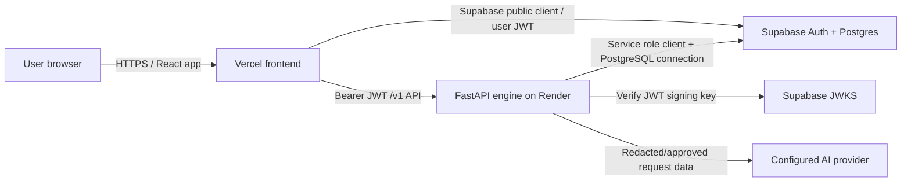
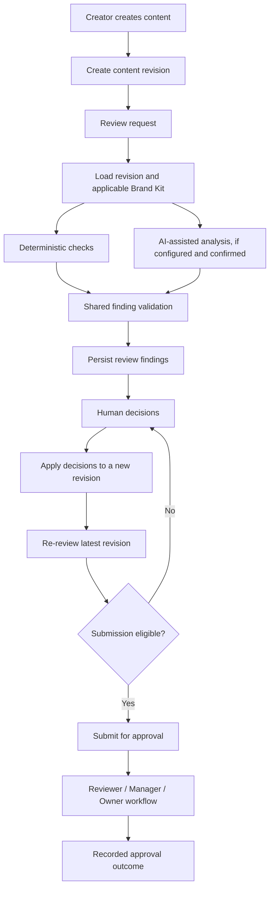

# AnchorDraft — System Architecture

**Document status:** As-built architecture reference  
**Last updated:** 13 November 2026  
**Repository:** [SiddharthaOG/AnchorDraft](https://github.com/SiddharthaOG/AnchorDraft)

This document describes the implemented application architecture. Earlier planning decisions are retained as historical context where useful; this document is not a pre-build proposal.

## 1. System overview

AnchorDraft is an organisation-aware content and brand-compliance platform. It combines structured Brand Kits, deterministic validation, AI-assisted analysis, revision-aware review state, confidentiality controls, and human approval workflows.

The system is split into four principal areas:

1. **Web application** — authenticated user interface and organisation workflows.
2. **FastAPI engine** — trusted API boundary, authentication/authorisation checks, validation, imports, linting, and review orchestration.
3. **Supabase** — identity, PostgreSQL data, Row Level Security, and database functions.
4. **External AI providers** — optional providers behind a backend adapter; provider credentials remain server-side.

## 2. Deployment topology

| Component | Technology | Deployment | Responsibility |
|---|---|---|---|
| Frontend | React 19, TypeScript, Vite 8, Tailwind CSS 4 | Vercel | UI, routing, authenticated user experience |
| Backend | Python, FastAPI, asyncpg, Supabase Python client | Render | Trusted API, validation, workflow enforcement, review processing |
| Identity | Supabase Auth | Supabase | User authentication and access tokens |
| Database | PostgreSQL, Supabase | Supabase | Organisation data, content, revisions, Brand Kits, findings, decisions, approvals and audit records |
| AI adapters | Groq and Gemini adapters; fake adapter for local/test | Called by backend | Text and vision analysis where configured |

Production endpoints:
- Frontend: https://anchordraft.vercel.app/
- Backend health: https://anchordraft.onrender.com/v1/health

## 3. System context and trust boundaries

| Component | Trust boundary | Rules |
|---|---|---|
| Browser | Untrusted | Never holds service-role or provider secrets. Client-supplied roles and organisation IDs are not trusted. |
| Supabase Auth | Identity authority | Issues access tokens; the backend verifies signature, expiry, issuer and audience. |
| PostgreSQL/RLS | Data access boundary | Organisation membership and role-aware policies protect browser-side data access. |
| FastAPI engine | Trusted server boundary | Verifies JWTs, derives membership and roles, validates input, and performs privileged operations. |
| AI provider | External processor | Receives only data passed by the backend processing flow; confidentiality controls apply before outbound processing. |
| User content and uploaded files | Untrusted input | Treated as data, not instructions; file type/size and content validation apply. |

The Supabase service-role key, database connection string, JWT verification configuration, encryption key, and AI-provider keys belong only in the backend environment. The browser uses the public Supabase anon/publishable key.

## 4. Authentication and organisation scoping

1. The browser signs in through Supabase Auth and obtains an access token.
2. Requests to protected FastAPI routes include `Authorization: Bearer <access-token>`.
3. The engine verifies the JWT using the configured Supabase JWKS endpoint, issuer, audience, and an explicit signing-algorithm allowlist.
4. The engine extracts the authenticated user ID from the verified token.
5. The engine loads the user's organisation memberships and role assignments from Supabase.
6. Endpoint dependencies enforce the required role and a valid organisation context.
7. Organisation IDs and roles supplied by the client are not treated as authority.

The frontend also uses Supabase directly for supported user-facing data access, with PostgreSQL RLS and guarded database functions enforcing the database boundary.

## 5. Core domain and review workflow

The principal domain concepts are:

- **Organisation and membership:** tenant boundary and role assignments.
- **Brand Kit:** versioned set of rules, approved facts, and visual guideline configuration.
- **Content:** the managed item being reviewed.
- **Revision:** immutable version of content text.
- **Review:** a processing run associated with a content revision and kit version.
- **Finding:** a deterministic or AI-assisted issue, linked to a rule or approved fact and a quoted text span where applicable.
- **Decision:** a human accept/edit/dismiss decision on a finding.
- **Approval:** workflow outcome and sign-off state.
- **Guideline suggestion:** proposed change derived from recurring review outcomes, subject to human approval.
- **Confidentiality policy and preview:** organisation settings and a short-lived redacted outbound-payload confirmation flow.
- **Audit log:** record of important administrative and workflow operations.

### Revision-aware submission invariant

Findings and decisions belong to a particular review/revision context. Submission eligibility must be evaluated against the latest content revision and its applicable review state. An older review or decision must not be used to bypass unresolved findings on a newer revision.

The server-side workflow and database operations are designed to preserve this invariant; the client cannot simply declare a submission eligible.

## 6. Review engine and provider boundary

The engine supports deterministic checks and AI-assisted analysis through provider adapters.

- Supported provider adapter types in code: `groq`, `gemini`, and `fake`.
- The fake provider is for local/test environments and is rejected in staging/production.
- Primary and fallback provider settings are configurable.
- Gemini supports a distinct fallback model for same-provider transient failures.
- Transient provider failures and timeouts can trigger fallback within a bounded overall request deadline.
- Findings pass through shared validation before persistence; invalid citations or quotes should not be accepted as valid findings.
- Provider credentials and prompt processing remain server-side.

The exact deployed provider and model are runtime configuration, not inferred from the repository defaults. Quotas, model availability, and provider data terms depend on the configured account and must be reviewed separately.

## 7. Confidentiality-aware processing

The confidentiality flow introduces a deliberate checkpoint before external AI processing:

1. Load the organisation's confidentiality policy.
2. Redact configured sensitive patterns and custom terms from text before provider processing.
3. Prepare the outbound payload and its hash.
4. Present the redacted outbound-data preview to the user.
5. Require explicit confirmation before processing.
6. Store only the redacted provider prompt and payload hash in the preview record.
7. Keep the placeholder reverse map encrypted with `PREVIEW_ENCRYPTION_KEY`, then clear it after terminal processing.
8. Expire preview records after the configured short lifetime.

Important boundary: attached image bytes are not OCR-redacted. When images are sent to a vision provider, explicit creator consent is required. The workflow is a safeguard, not a guarantee that sensitive information can never be exposed.

## 8. Guideline-gap analytics

The analytics workflow examines recurring review outcome patterns to identify guidelines that may be unclear or repeatedly misunderstood. It applies evidence thresholds and deterministic clustering, then presents proposed guideline improvements.

Suggestions are not silently applied:
- A human reviewer with the appropriate role accepts or rejects the suggestion.
- Acceptance follows the Brand Kit draft/version workflow.
- Suggestion lifecycle operations are organisation-scoped and auditable.

This feature should be described as pattern-based decision support, not a statistically validated model or a system with established precision/recall metrics.

## 9. API and data-access surfaces

AnchorDraft uses three related access surfaces:

| Surface | Typical use | Enforcement |
|---|---|---|
| FastAPI REST API under `/v1` | Review processing, imports, kit linting, confidentiality and analytics operations | JWT verification, server-side role checks, organisation scoping, validation |
| Supabase client under RLS | Supported browser-side reads and user-facing data operations | Supabase Auth identity and PostgreSQL RLS |
| Supabase RPC/database functions | Guarded workflow state changes and atomic operations | Function-level identity/role/state checks and restricted execute permissions |

The API surface has expanded beyond the original four-endpoint planning scope. Consult the running FastAPI OpenAPI document and current route modules for the implemented endpoint list.

## 10. Runtime configuration

### Frontend

- `VITE_ENGINE_URL`
- `VITE_SUPABASE_URL`
- `VITE_SUPABASE_ANON_KEY`

### Backend

- `ENVIRONMENT`
- `DATABASE_URL`
- `SUPABASE_URL`
- `SUPABASE_SERVICE_ROLE_KEY`
- `SUPABASE_JWKS_URL`
- `SUPABASE_ISSUER`
- `SUPABASE_AUDIENCE`
- `ALLOWED_ORIGINS`
- `PREVIEW_ENCRYPTION_KEY`
- `LLM_PROVIDER`, `LLM_FALLBACK_PROVIDER`, `LLM_FALLBACK_ENABLED`
- Provider-specific credentials and model/rate-limit settings
- Review, upload, request, and rate-limit settings

See [engine/README.md](../engine/README.md), [engine/.env.example](../engine/.env.example), and [web/.env.example](../web/.env.example) for setup details. Never commit real values.

## 11. Deployment and local development

- Vercel serves the frontend from the `web/` root.
- Render serves the FastAPI application from the `engine/` root.
- Supabase hosts Auth and PostgreSQL.
- Local development uses the Supabase CLI and a Docker-compatible runtime.
- SQL migrations are versioned in `supabase/migrations/`; demo seed scripts are separate because they require actual local Auth user UUIDs.

For a fresh checkout, follow the root [README](../README.md) and [Supabase migration guide](../supabase/migrations/README.md).

Never run a destructive remote reset against the shared or production Supabase project. Review migration status and use the normal migration deployment workflow.

## 12. Key architecture decisions

The following decisions remain important to the implemented system:

1. Reviews run asynchronously and expose explicit status.
2. Privileged review writes are performed by the trusted backend/service-only database operations.
3. Text offsets are computed and validated server-side rather than trusted from model output.
4. Brand Kits are versioned and rules use stable identifiers.
5. Deterministic and AI-assisted findings share validation requirements.
6. LLM integrations sit behind a provider adapter.
7. Schema changes are versioned as SQL migrations.
8. Workflow state transitions use guarded, atomic database functions where defined.
9. Model failure does not erase valid deterministic findings; review state records the AI outcome.
10. Applying decisions creates a new revision rather than mutating historical revision text.
11. Findings must cite applicable rules/facts and actual content spans before persistence.
12. Organisation and role checks are enforced at server/database boundaries.
13. Confidentiality preview/confirmation and human approval are explicit parts of the processing workflow.

The historical decision log is maintained in [docs/ai-log/decisions.md](ai-log/decisions.md).

## 13. Known limitations and operational considerations

- Visual compliance is structured and rule-based; it is not pixel-perfect visual comparison or automated logo recognition.
- AI-assisted findings can be incorrect and require human review.
- Provider quotas, availability, and data terms vary by account and plan.
- Image bytes are not OCR-redacted by the text confidentiality pipeline.
- Automated test success does not establish large-scale production reliability or real-world model accuracy.
- Staging and production have shared database infrastructure; changes must be handled with particular care.
- Some capabilities remain future work or are marked as coming soon in the product. Do not infer implementation from a roadmap entry.

## 14. Verification baseline

The final-round repository verification reported:
- Backend automated tests: 790 passed, 4 skipped.
- Frontend automated tests: 235 passed.
- Frontend production build: passed.
- Git whitespace validation: clean.

These are the recorded suite results for the final-round code state; they are not a claim of exhaustive authenticated production browser coverage.
