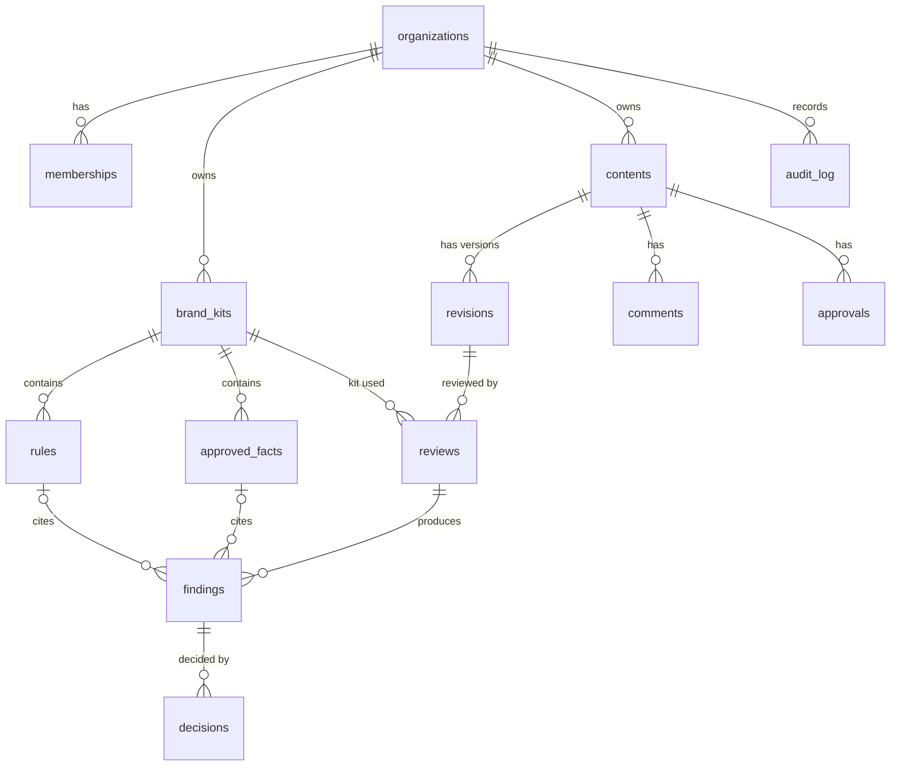

# DATA_MODEL.md — AnchorDraft (Phase 2)

**Status:** DRAFT for review, revision 2. Planning document written on 3 Nov 2026, before the Round 2 build window opens (4 Nov 10:00). It contains no application code. SQL fragments are specification sketches; the agent writes the final migrations after the window opens, and every item marked **VERIFY** must be checked against current Supabase/Postgres documentation before it is trusted.

**Companion documents:** `ARCHITECTURE.md` (Phase 1), `API_CONTRACT.md` (Phase 3), `REVIEW_ENGINE.md` (Phase 4).

**Change log**
- Rev 1 (3 Nov): initial data model.
- Rev 3 (3 Nov): `reviews` gains `validator_stats`; the review service writes results through one atomic service-only function (`REVIEW_ENGINE.md` section 8).
- Rev 2 (3 Nov): state changes now go through database functions instead of triggers (decision agreed by the architect); `reviews` gains `llm_status` and `warnings` for partial results; direct INSERT on `revisions`, `decisions` and `approvals` is revoked; content metadata is not editable in Tier 1; offsets are Unicode code points.

**Scope:** Tier 1 and Tier 2 of the Round 2 build. Tier 3 and Round 3 items are listed in section 12 so the schema does not block them.

---

## 1. Design principles

1. **Citation-first.** A finding must reference exactly one rule or one approved fact. The database refuses anything else.
2. **Org isolation.** Every table carries `org_id`. Row Level Security (RLS) isolates organisations. The browser can never choose an `org_id` for a child row; a trigger copies it from the parent.
3. **Append-only history.** Revisions, decisions, approvals, comments and the audit log are never updated or deleted. History is the product (track changes, audit trail, insights).
4. **Immutable kits once active.** A brand kit used for a review can never change afterwards, so any finding can be explained later.
5. **Only the review service writes findings.** Users read them and record decisions about them. Users never insert or edit findings.
6. **State transitions are enforced in the database,** inside atomic `SECURITY DEFINER` functions, not only in the UI. Users cannot write the workflow tables directly.
7. **Simplest thing that works in 72 hours.** Roles are an array, content format is plain text/Markdown, no vector tables, no job-queue tables.

## 2. Entity overview



## 3. Enumerated types

| Type | Values |
|---|---|
| `app_role` | `creator`, `manager`, `reviewer`, `owner` (owner = Guideline Owner) |
| `kit_status` | `draft`, `active`, `archived` |
| `rule_category` | `tone`, `terminology`, `messaging`, `claim`, `fact`, `accessibility` |
| `severity` | `low`, `medium`, `high` |
| `check_kind` | `deterministic`, `llm` |
| `content_status` | `draft`, `submitted`, `changes_requested`, `approved` |
| `revision_source` | `manual`, `accepted_suggestion`, `import` |
| `review_status` | `queued`, `running`, `done`, `failed` |
| `finding_source` | `deterministic`, `llm` |
| `llm_status` | `ok`, `skipped`, `failed` |
| `decision_action` | `accept`, `edit`, `dismiss` |
| `approval_action` | `approve`, `request_changes`, `signoff`, `reject_claim` |

## 4. Tables

Conventions: `id uuid primary key default gen_random_uuid()`; timestamps are `timestamptz not null default now()`; `org_id uuid not null references organizations(id)` on every table except `organizations` and `profiles`.

### 4.1 Identity and membership

**organizations** — `id`, `name text not null`, `created_at`.

**profiles** — `user_id uuid primary key references auth.users(id) on delete cascade`, `display_name text not null`, `created_at`.

**memberships** — PK (`org_id`, `user_id`).
`roles app_role[] not null default '{creator}' check (cardinality(roles) > 0)`, `created_at`.
One person may hold several roles (typical in a startup). Roles are permissions, not separate accounts.

### 4.2 Brand kit

**brand_kits**
| Column | Type | Notes |
|---|---|---|
| `id`, `org_id` | uuid | |
| `version` | int not null | unique per org |
| `name` | text not null | |
| `status` | kit_status default `draft` | |
| `source_kit_id` | uuid null | kit this one was cloned from |
| `created_by` | uuid → auth.users | |
| `created_at`, `activated_at` | timestamptz | `activated_at` null until active |

Constraints: `unique (org_id, version)`; partial unique index `on (org_id) where status = 'active'` (one active kit per org).

**rules**
| Column | Type | Notes |
|---|---|---|
| `id`, `org_id`, `kit_id` | uuid | `org_id` copied from kit by trigger |
| `rule_key` | text not null | stable ID such as `TERM-12`; check `rule_key ~ '^[A-Z0-9]+-[0-9]{2,3}$'` |
| `category` | rule_category not null | |
| `title` | text not null | |
| `guideline_text` | text not null | the guideline wording shown to users and sent to the model |
| `severity` | severity not null default `medium` | |
| `check_kind` | check_kind not null | `deterministic` rules have `config`; `llm` rules rely on `guideline_text` |
| `config` | jsonb null | parameters for deterministic checks (shape defined in Phase 4) |
| `needs_reviewer` | boolean not null default false | true for `claim` and `fact` categories unless the owner overrides |
| `example_bad`, `example_good` | text null | optional, used in prompts and UI |

Constraint: `unique (kit_id, rule_key)`. **Rule keys are stable across kit versions** so insights over time still refer to the same rule after a reword.

**approved_facts**
| Column | Type | Notes |
|---|---|---|
| `id`, `org_id`, `kit_id` | uuid | |
| `fact_key` | text not null | e.g. `FACT-04`; same pattern check as rules |
| `statement` | text not null | the approved wording |
| `source_note` | text not null | where it is approved from (document, page, date) |
| `valid_until` | date null | facts past this date are excluded from prompts and flagged in the kit UI (ASSUMPTION) |

Constraint: `unique (kit_id, fact_key)`.

### 4.3 Content and revisions

**contents**
| Column | Type | Notes |
|---|---|---|
| `id`, `org_id` | uuid | |
| `title` | text not null | |
| `channel` | text not null default `other` | check in (`linkedin`,`blog`,`email`,`website`,`other`) |
| `purpose` | text not null | creator-stated intent; suggestions must preserve it |
| `status` | content_status default `draft` | changed only by the workflow functions (section 7) |
| `created_by` | uuid → auth.users | |
| `created_at`, `updated_at` | timestamptz | |

The current revision is the highest `version` for the content (see view `v_latest_revision`). There is deliberately no `current_revision_id` column, which avoids a circular foreign key. Title, channel and purpose are **not editable in Tier 1**: a different purpose means a new content item.

**revisions** — append-only; inserted only by the database functions in section 8.4.
| Column | Type | Notes |
|---|---|---|
| `id`, `org_id`, `content_id` | uuid | `org_id` copied from content by trigger |
| `version` | int not null | contiguous per content; `unique (content_id, version)` |
| `parent_revision_id` | uuid null | previous revision |
| `body` | text not null | check `length(body) between 1 and 20000` (ASSUMPTION: 20,000 character cap) |
| `source` | revision_source not null | |
| `created_by` | uuid | |
| `created_at` | timestamptz | |

Format ASSUMPTION: plain text or Markdown with `\n` line endings (normalised on insert). Missing alt text is detected from Markdown image syntax (``).

### 4.4 Reviews and findings

**reviews** — written only by the review service.
| Column | Type | Notes |
|---|---|---|
| `id`, `org_id` | uuid | |
| `revision_id` | uuid → revisions | |
| `kit_id` | uuid → brand_kits | the exact kit version used |
| `status` | review_status default `queued` | |
| `error` | text null | safe, user-readable message when `failed` |
| `engine_version` | text not null | |
| `model` | text null | null for deterministic-only runs |
| `prompt_version` | text null | |
| `llm_status` | llm_status not null default `ok` | `ok`: the model call succeeded; `skipped`: the kit has no model-checked rules; `failed`: the call failed or timed out and only deterministic findings exist |
| `warnings` | jsonb not null default `'[]'` | safe, user-readable notes such as "model unavailable: deterministic checks only" |
| `llm_findings_raw` | int default 0 | findings the model returned |
| `llm_findings_dropped` | int default 0 | findings the validator rejected (a reliability metric) |
| `validator_stats` | jsonb not null default `'{}'` | counts only, for example `{"raw":14,"kept":9,"dropped":{"unknown_ref":2}}`; never any text |
| `requested_by` | uuid | |
| `created_at`, `started_at`, `finished_at` | timestamptz | |

A retry creates a new review row, so failures stay in the history. A review whose model call failed still ends as `done` with `llm_status = failed`, so users keep the deterministic findings (partial results); it cannot be submitted for approval until a review with `llm_status` of `ok` or `skipped` exists.

**findings** — written only by the review service.
| Column | Type | Notes |
|---|---|---|
| `id`, `org_id`, `review_id` | uuid | |
| `source` | finding_source not null | |
| `rule_id` | uuid null → rules | |
| `fact_id` | uuid null → approved_facts | |
| `ref_key` | text not null | copy of `rule_key` or `fact_key`; stable across kit versions |
| `category` | rule_category not null | copied at write time |
| `severity` | severity not null | copied at write time |
| `quote` | text not null | exact text from the revision body |
| `start_offset`, `end_offset` | int not null | Unicode code-point offsets (not UTF-16 units), computed by the server from `quote`, never taken from the model |
| `explanation` | text not null | |
| `suggestion` | text null | |
| `confidence` | numeric(3,2) null | 0.00 to 1.00 |
| `needs_human` | boolean not null default false | low confidence or ambiguous |
| `needs_reviewer` | boolean not null default false | true for claim/fact findings that require sign-off |
| `created_at` | timestamptz | |

Constraints: `check (num_nonnulls(rule_id, fact_id) = 1)`; `check (start_offset >= 0 and end_offset > start_offset)`; `check (confidence is null or confidence between 0 and 1)`. Whether the offsets really fit the revision body is enforced by the validator, because a table check cannot read another table.

### 4.5 Human decisions and workflow

**decisions** — append-only; written only by `record_decision` and `apply_decisions`; the latest row per finding is its current state.
| Column | Type | Notes |
|---|---|---|
| `id`, `org_id`, `finding_id` | uuid | |
| `user_id` | uuid | must equal the signed-in user |
| `action` | decision_action not null | |
| `reason` | text null | **required for `dismiss`** |
| `edited_text` | text null | creator's own wording for `edit` |
| `resulting_revision_id` | uuid null | set by `apply_decisions` when the decision's change was applied to a new revision |
| `created_at` | timestamptz | |

Constraint: `check (action <> 'dismiss' or (reason is not null and length(btrim(reason)) > 0))`.

**comments** — append-only.
`id`, `org_id`, `content_id`, `revision_id null`, `finding_id null`, `user_id`, `body text check (length(body) between 1 and 2000)`, `created_at`.

**approvals** — append-only; written only by `request_changes`, `record_signoff` and `approve_content`.
| Column | Type | Notes |
|---|---|---|
| `id`, `org_id`, `content_id`, `revision_id` | uuid | |
| `finding_id` | uuid null | set for `signoff` and `reject_claim` |
| `user_id` | uuid | must equal the signed-in user |
| `action` | approval_action not null | |
| `note` | text null | required for `request_changes` and `reject_claim` |
| `created_at` | timestamptz | |

Constraints: `signoff` and `reject_claim` require `finding_id`; `approve` and `request_changes` require `finding_id is null`; notes are required where stated above.

**audit_log** — append-only.
`id bigint generated always as identity`, `org_id`, `actor_id uuid null`, `action text`, `entity_type text`, `entity_id uuid`, `detail jsonb`, `created_at`. Written by the workflow functions and the review service. Readable by managers and owners.

## 5. Invariants the database must enforce

| # | Invariant | Mechanism |
|---|---|---|
| 1 | One active kit per org | partial unique index |
| 2 | Rules and facts of a non-draft kit cannot change | RLS policy (draft kits only); `clone_kit` and `activate_kit` guards |
| 3 | A finding cites exactly one rule or fact | check constraint |
| 4 | Child rows always carry the parent's `org_id` | small BEFORE INSERT trigger copies it; the functions also set it from the parent |
| 5 | Append-only tables are never updated or deleted | no UPDATE or DELETE policies, and UPDATE/DELETE privileges revoked from `authenticated` and `anon` |
| 6 | Dismissal needs a reason | check constraint, plus a guard in `record_decision` |
| 7 | Revision versions are contiguous per content | the functions assign `max(version)+1` while holding a row lock on the content (`select ... for update`); `unique (content_id, version)` is the backstop |
| 8 | Only the latest revision can be approved | `approve_content` |
| 9 | Approval requires a sign-off for every `needs_reviewer` finding in the latest review | `approve_content` reading `v_pending_signoffs` |
| 10 | Users cannot write `reviews` or `findings` | no privileges for `authenticated`; the review service uses the service role key |
| 11 | `contents.status` changes only inside the workflow functions | UPDATE privilege revoked; the functions run as `SECURITY DEFINER` |
| 12 | Users cannot INSERT `revisions`, `decisions` or `approvals` directly | INSERT privilege revoked from `authenticated`; only the functions write them |
| 13 | A review whose model call failed cannot be submitted for approval | `submit_content` guard on `llm_status` |

## 6. Versioning

**Brand kits.** To change guidelines: clone the active kit into a new `draft` kit (new `version`, same `rule_key`s), edit it, then activate it. Activation archives the previous active kit and stamps `activated_at`. Reviews keep pointing at the kit they used, so old findings stay explainable.

**Content revisions.** Each edit, accepted suggestion or import creates a new revision with `parent_revision_id`. Reviews attach to a specific revision, so findings always refer to the exact text they were found in.

**Reproducibility.** Every review stores `kit_id`, `model`, `prompt_version` and `engine_version`.

## 7. State machines

### Content status

| From | To | Function (role) | Guard |
|---|---|---|---|
| `draft` | `submitted` | `submit_content` (creator) | latest revision has a `done` review with `llm_status` of `ok` or `skipped`; every finding in it has a decision; no accepted or edited decision is waiting to be applied |
| `submitted` | `approved` | `approve_content` (manager) | approving the latest revision; no pending sign-offs |
| `submitted` | `changes_requested` | `request_changes` (manager) or `record_signoff` with `reject_claim` (reviewer) | note required |
| `changes_requested` | `draft` | `create_revision` or `apply_decisions` (creator) | automatic when a new revision is created |

`approved` is terminal in Tier 1. Revisions can only be created while status is `draft` or `changes_requested`.

### Review status
`queued` → `running` → `done` or `failed`. `failed` means no usable result (for example the revision could not be loaded). A model failure alone produces `done` with `llm_status = failed` and a warning. A review stuck in `running` for more than 5 minutes (ASSUMPTION) is marked `failed` by the engine's startup sweep and by a lazy check when the UI polls it.

## 8. Access control

Two layers: **RLS** controls what each user can read (and the few direct writes), and **database functions** are the only way to change workflow state.

### 8.1 Helper functions (sketch)

Helpers live in a schema that is **not** exposed through the Supabase API (VERIFY how exposed schemas are configured), so they cannot be called as RPC. The workflow functions in 8.4 must be callable, so they live in an exposed schema and call the helpers.

```sql
create schema if not exists private;

create or replace function private.is_member(_org uuid)
returns boolean language sql stable security definer set search_path = ''
as $$
  select exists (
    select 1 from public.memberships m
    where m.org_id = _org and m.user_id = (select auth.uid())
  )
$$;

create or replace function private.has_role(_org uuid, _role public.app_role)
returns boolean language sql stable security definer set search_path = ''
as $$
  select exists (
    select 1 from public.memberships m
    where m.org_id = _org and m.user_id = (select auth.uid()) and _role = any (m.roles)
  )
$$;
```

`SECURITY DEFINER` avoids recursive RLS on `memberships`. Wrapping `auth.uid()` in `(select ...)` is the usual performance advice (VERIFY).

### 8.2 Access matrix

All policies apply to role `authenticated` and require membership of the row's organisation. `anon` has no access to anything. `—` means no direct access, so the operation is denied.

| Table | SELECT | Direct INSERT | Direct UPDATE/DELETE | Written by |
|---|---|---|---|---|
| organizations | members | — | — | seed / admin |
| profiles | members of a shared org; self | self | self (update) | the user |
| memberships | members | — | — | seed / admin |
| brand_kits | members | — | — | `clone_kit`, `activate_kit` |
| rules, approved_facts | members | owner, draft kit only | owner, draft kit only | the owner, directly |
| contents | members | — | — | `create_content` and the workflow functions |
| revisions | members | — | — | `create_content`, `create_revision`, `apply_decisions` |
| reviews | members | — | — | review service (service-only function) |
| findings | members | — | — | review service (service-only function) |
| decisions | members | — | — | `record_decision`, `apply_decisions` |
| comments | members | any member, as self | — | the user, directly |
| approvals | members | — | — | `request_changes`, `record_signoff`, `approve_content` |
| audit_log | manager, owner | — | — | the functions and the review service |

### 8.3 Policy sketches

```sql
alter table public.contents enable row level security;

create policy contents_select on public.contents
  for select to authenticated
  using (private.is_member(org_id));
```

```sql
-- rules: only the owner, only while the kit is still a draft
create policy rules_write on public.rules
  for all to authenticated
  using (
    private.has_role(org_id, 'owner')
    and exists (select 1 from public.brand_kits k
                where k.id = rules.kit_id and k.status = 'draft')
  )
  with check (
    private.has_role(org_id, 'owner')
    and exists (select 1 from public.brand_kits k
                where k.id = rules.kit_id and k.status = 'draft')
  );
```

```sql
-- comments: any member, as themselves
create policy comments_insert on public.comments
  for insert to authenticated
  with check (
    user_id = (select auth.uid())
    and private.is_member(org_id)
  );
```

**VERIFY:** qualifying outer columns inside policy subqueries (for example `rules.kit_id`), and that Realtime change events respect these policies.

### 8.4 Workflow functions

Each function is one atomic call from the browser (`supabase.rpc`). The full contract (parameters, returns, errors) is in `API_CONTRACT.md`, section 7. Summary:

| Function | Role | Effect |
|---|---|---|
| `create_content` | creator | creates the content and revision 1 |
| `create_revision` | creator | adds a manual revision |
| `record_decision` | creator | records accept, edit or dismiss for a finding |
| `apply_decisions` | creator | builds a new revision from accepted and edited decisions |
| `submit_content` | creator | `draft` → `submitted` |
| `request_changes` | manager | `submitted` → `changes_requested` |
| `record_signoff` | reviewer | sign-off, or claim rejection which sets `changes_requested` |
| `approve_content` | manager | `submitted` → `approved` |
| `clone_kit` | owner | copies a kit into a new draft version |
| `activate_kit` | owner | activates a draft kit and archives the previous one |

**Service-only functions.** The review service writes a finished review through one atomic function, `engine_complete_review`, which also has a failure form. Execute permission is revoked from `public`, `anon` and `authenticated` and granted only to the service role (VERIFY). It inserts all findings and updates the review row in one transaction, so a review is never half-written. See `REVIEW_ENGINE.md` section 8.

**Hardening rules (apply to every function):**
1. `SECURITY DEFINER` with `set search_path = ''` and fully qualified object names.
2. First statement: read `auth.uid()` and raise `unauthenticated` if it is null.
3. Check membership and role with `private.has_role` against the row's real organisation, never against a value supplied by the caller.
4. Lock the content row (`select ... for update`) before reading state that the function will change.
5. Validate every input (length, enum, null) before writing.
6. Write an `audit_log` row for each state change.
7. No dynamic SQL.
8. `revoke all on function ... from public, anon; grant execute on function ... to authenticated;` (VERIFY the exact Supabase permission model).
9. Return a small, fixed result shape and raise errors using the codes in `API_CONTRACT.md` section 4.

**Sketch (`approve_content`)** — illustrative only; the agent writes and tests the real function:

```sql
create or replace function public.approve_content(_content_id uuid)
returns void language plpgsql security definer set search_path = ''
as $$
declare
  _uid    uuid := (select auth.uid());
  _org    uuid;
  _status public.content_status;
  _rev    uuid;
begin
  if _uid is null then raise exception 'unauthenticated'; end if;

  select org_id, status into _org, _status
  from public.contents where id = _content_id for update;
  if not found then raise exception 'not_found'; end if;

  if not private.has_role(_org, 'manager') then raise exception 'forbidden'; end if;
  if _status <> 'submitted' then raise exception 'conflict: content is not submitted'; end if;

  select id into _rev from public.revisions
  where content_id = _content_id order by version desc limit 1;

  if exists (select 1 from public.v_pending_signoffs p where p.content_id = _content_id) then
    raise exception 'conflict: sign-offs pending';
  end if;

  insert into public.approvals (org_id, content_id, revision_id, user_id, action)
  values (_org, _content_id, _rev, _uid, 'approve');

  update public.contents set status = 'approved', updated_at = now() where id = _content_id;

  insert into public.audit_log (org_id, actor_id, action, entity_type, entity_id)
  values (_org, _uid, 'content.approved', 'content', _content_id);
end $$;
```

**VERIFY:** how PostgREST maps raised exceptions to HTTP responses (custom status codes), and how the browser client reads the message.

### 8.5 Storage (Tier 2)
One private bucket for uploads. Object paths start with `<org_id>/`. Policies allow read and write only to members of that org. Extracted text, not the file, is what enters `revisions.body`. Uploaded files can also be read through the review service's stateless import endpoint without being stored at all.

## 9. Derived views

Views use `security_invoker` so the caller's RLS applies (VERIFY: requires a recent Postgres version).

**v_latest_revision** — for each content, its highest-version revision.

**v_finding_state** — each finding joined to its latest decision.
```sql
create view public.v_finding_state with (security_invoker = true) as
select f.*, d.action as last_action, d.reason as last_reason, d.created_at as decided_at
from public.findings f
left join lateral (
  select * from public.decisions d
  where d.finding_id = f.id
  order by d.created_at desc
  limit 1
) d on true;
```

**v_pending_signoffs** — findings with `needs_reviewer = true` in the latest `done` review of a content's latest revision that have no `signoff` approval. (The agent writes this view and tests it.)

**v_rule_stats** — per organisation and `ref_key`: findings, dismissed, acted-on, dismissal rate, last seen. This feeds the insights page and, later, the guideline-gap analytics.
```sql
create view public.v_rule_stats with (security_invoker = true) as
select
  s.org_id, s.ref_key, s.category,
  count(*)                                              as findings,
  count(*) filter (where s.last_action = 'dismiss')     as dismissed,
  count(*) filter (where s.last_action in ('accept','edit')) as acted_on,
  round(
    count(*) filter (where s.last_action = 'dismiss')::numeric
    / nullif(count(*) filter (where s.last_action is not null), 0), 2
  )                                                     as dismissal_rate,
  max(s.created_at)                                     as last_seen
from public.v_finding_state s
group by s.org_id, s.ref_key, s.category;
```

**"Possibly unclear" rules** = rows in `v_rule_stats` with at least 5 decided findings and a dismissal rate of 0.5 or more. Both thresholds are ASSUMPTIONS and are parameters in the UI, not constants in the schema.

**Reliability metric** = `sum(llm_findings_dropped) / sum(llm_findings_raw)` over `reviews`. It shows how often the validator had to step in, which is useful evidence in Round 2 and Round 3.

## 10. Indexes

- `memberships (user_id)`
- `brand_kits (org_id, status)`
- `rules (kit_id)`, `approved_facts (kit_id)`
- `contents (org_id, status, created_at desc)`
- `revisions (content_id, version desc)`
- `reviews (revision_id, created_at desc)`, `reviews (org_id, status)`
- `findings (review_id)`, `findings (org_id, ref_key)`
- `decisions (finding_id, created_at desc)`
- `approvals (content_id, created_at desc)`, `approvals (finding_id)`
- `comments (content_id, created_at)`
- `audit_log (org_id, created_at desc)`

## 11. Seed data specification (fictional, created inside the build window)

- 1 fictional organisation (a sample startup).
- 4 demo accounts: one holding `owner` and `manager`, two `creator`s, one `reviewer`.
- 1 active kit (v1): about 15 rules (terminology, claims, tone, messaging, accessibility) and 5 approved facts, each with a `source_note`.
- 1 sample content with two revisions, used as the demo scenario.
- The 30-post benchmark lives in the repository as data files, not in the schema (designed in Phase 5).

## 12. Deliberately deferred

| Item | Round |
|---|---|
| `brand_assets` (logos, palettes, image metadata) | Round 3, visual review |
| `source_files` (upload registry) | Tier 2 if time allows |
| `redaction_rules`, extended audit export | Round 3, confidentiality layer |
| `rule_embeddings` (pgvector) for retrieval over large kits | later |
| Clustering of dismissal reasons, proposed rule rewordings | Round 3, guideline-gap analytics |
| Invitations and self-serve organisation creation | later |

## 13. Open questions and decisions

**Decided (3 Nov):**
- State changes use database functions, not triggers.
- Partial results when the model fails (`llm_status`, `warnings`).
- Content title, channel and purpose are not editable in Tier 1.
- Decisions and applying them are separate steps (`record_decision`, then `apply_decisions`), so one batch of accepted suggestions makes one revision and one re-review.

**Still open (recommendation in italics):**
- **Q1 — Re-review noise.** After `apply_decisions`, the new revision is reviewed again, and a dismissed finding can reappear and need a second decision. *Accept this in Tier 1. In Tier 2, carry decisions forward when `ref_key` and `quote` match a dismissed finding on the parent revision (adds a column such as `carried_from_decision_id`).*
- **Q2 — Visibility.** Currently every org member can see all content. *Keep org-wide for simplicity.*
- **Q3 — Roles as an array** versus a separate table. *Keep the array.*
- **Q4 — Onboarding.** Users are seeded into organisations for the demo, with no invitation flow. A user who signs up without a membership sees nothing. *Disable open sign-up, or show a "no organisation" screen.*
- **Q5 — Cost control.** Cap reviews per organisation per day (ASSUMPTION: 20) in the review service, not the schema.
- **Q6 — Deterministic `config` shape** is defined in Phase 4.

## 14. Items to VERIFY before relying on them

1. `security_invoker` views and the Postgres version Supabase provides.
2. How Supabase exposes schemas, so `private` functions are not callable as RPC.
3. Column qualification inside policy subqueries.
4. Realtime delivery respecting RLS.
5. Whether the service role key bypasses RLS as expected, and that it is never exposed to the browser.
6. Exact Supabase permission model for `SECURITY DEFINER` functions in an exposed schema (revoking from `public` and `anon`, granting to `authenticated`), and how raised exceptions reach the browser client.

## 15. Review checklist (for the architect)

- [ ] Can I explain each table in one sentence, and why it exists?
- [ ] Is any table or column here something Tier 1 does not need? (Cut it.)
- [ ] Do the invariants in section 5 cover every way the demo could be corrupted?
- [ ] Is each role able to do exactly what the Round 1 PDF promises, and nothing more?
- [ ] Does the data model support the insights page and the reliability metric without extra tables?
- [ ] Are the open questions answered, with my decision written next to each?
- [ ] Does every function follow all nine hardening rules, and does each have a negative test (wrong role, wrong org, wrong state)?
- [ ] Can a user change workflow state in any way other than the ten functions?


## 16. Guideline-gap analytics (Improvement 3)

### `guideline_suggestions`
Stores human-governed wording proposals tied to an organisation, source kit/version, stable rule key, and exact source guideline text/hash. Status is one of `pending`, `accepted`, `rejected`, or `stale`. Evidence stores aggregate counts, dismissal rate, reason-cluster labels/counts, and contributing kit versions only; raw dismissal reasons are not copied into the suggestion record. A partial unique index permits one pending suggestion per source kit/rule.

### `guideline_suggestion_previews`
Stores a short-lived, one-time, redacted provider request. The reverse placeholder map is encrypted; only its ciphertext is persisted. Policy version/fingerprint, source guideline hash, payload hash, redaction counts, token hash, expiry, and consumption time are retained. The table is backend-only and has no authenticated read policy.

### Versioning and workflow invariants
- Analytics use the latest decision per finding and only pool historical decisions whose exact guideline wording matches the active rule.
- Accepting a proposal validates manager/owner membership, pending status, active source kit, source version, and source guideline text.
- Acceptance locks the organisation row, creates a new kit version, copies all rules/facts, changes only the targeted guideline, activates the new kit, resolves the proposal, and records an audit event in one transaction.
- The generic `clone_kit` allocator uses the same organisation-row lock to serialize version allocation.
