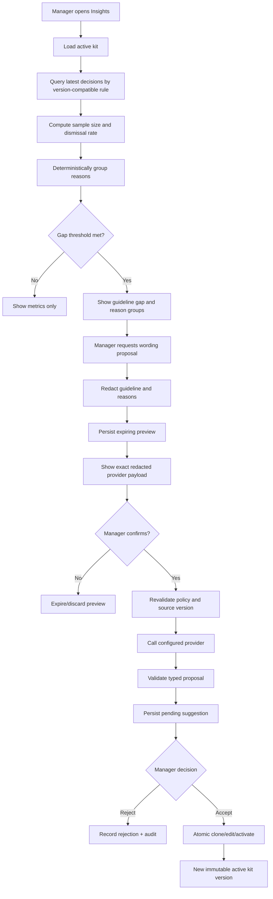

# Improvement 3 — Guideline-Gap Analytics
## Architecture and Workflow Design

**Status:** Implemented in this branch; staging verification pending
**Branch:** `feat/guideline-gap-analytics`
**Parent:** `main` (Improvement 2 is already merged; this PR contains Improvement 3 only)
**Scope:** Recurring dismissal analysis, grouped reasons, clearer-wording proposals, human accept/reject, and acceptance creating a new brand-kit version.

---

## 1. Product contract

Managers/owners can identify active-kit rules that are repeatedly dismissed, understand the recurring reasons, request a clearer wording proposal, and explicitly accept or reject it. Acceptance creates and activates a new immutable kit version. Rejection is retained as an auditable outcome.

### In scope
- Rule-level, version-aware dismissal metrics.
- Explainable deterministic grouping of dismissal reasons.
- Model-assisted wording proposals, only after an explicit preview/confirmation of the exact redacted provider payload.
- Human accept/reject with source-version and source-text staleness checks.
- Acceptance atomically creates, edits, and activates a new kit version.
- Audit metadata contains counts and identifiers, never dismissal text or raw prompt content.

### Out of scope
- Automatic rule edits or automatic activation.
- General-purpose analytics, real-time collaboration, or predictive scoring.
- Changes to the review/citation validator.
- Rewriting rules whose source version or wording changed after analysis.
- Sending unredacted dismissal reasons to any external provider.

## 2. Verified foundations

The live Supabase project contains:
- `decisions` with append-only `action`, `reason`, `edited_text`, `finding_id`, and timestamps.
- `findings` with `rule_id`, stable `ref_key`, category, and review linkage.
- `reviews.kit_id` to identify the exact kit version used by each review.
- `brand_kits` and `rules` with immutable versioned rules and stable `rule_key`.
- `v_finding_state`, which selects the latest decision per finding.
- `v_rule_stats`, which supplies existing aggregate metrics.
- Existing Insights UI, API client/data layer, FastAPI auth dependencies, asyncpg pool, provider abstraction, fake provider, and Improvement 2 confidentiality engine.

The current live `clone_kit(uuid)` implementation uses `MAX(version)+1` without locking. This is a verified concurrency defect and is a prerequisite for safe version creation.

## 3. Architecture decisions

### ADR-IG-01 — Version-aware evidence
Analytics are anchored to the organisation's active kit. Historical decisions are eligible only when they refer to the same stable `rule_key` and the historical rule's `guideline_text` exactly matches the active rule's current text. This safely pools unchanged wording across kit versions while excluding decisions against older wording. Each response exposes source kit/version counts so the evidence remains traceable.

Use the latest decision per finding (the semantics already provided by `v_finding_state`); do not count superseded decisions. Count only decided findings in the denominator. A gap requires at least 5 decided findings, a dismissal rate of at least 50%, and at least one reason cluster containing 2 or more reasons. Thresholds are named constants/configuration, not UI-derived values.

### ADR-IG-02 — Deterministic, explainable reason grouping
Normalize case, punctuation, and whitespace; tokenize; remove a small documented stop-word list; then cluster with a deterministic token-overlap/Jaccard rule. No HDBSCAN, embeddings, or extra ML dependencies. Return cluster counts, concise themes derived from common tokens, and bounded example reasons for the authorized manager view. Preserve unclustered reasons as an explicit "Other" group. Stable ordering makes tests and UI reproducible.

### ADR-IG-03 — Confidential suggestion generation
Suggestion generation is user-triggered and two-step:
1. Build a provider request from the active guideline and bounded reason examples. Apply the Improvement 2 `ConfidentialityPolicyStore` and `ConfidentialityEngine.redact_fields` before constructing the provider payload. Persist only the redacted preview, a hash, an encrypted reverse map, policy/version fingerprints, expiry, and a one-time token hash.
2. Display the exact redacted system/user content and redaction counts to the user. Only explicit confirmation consumes the token and calls the provider. Revalidate active kit, source guideline hash, and confidentiality policy fingerprint before the call.

The provider receives only redacted fields. Expand placeholders only in the returned proposal for display/storage; never restore values into prompts or logs. Audit events record counts, policy version, model identifier, and hashes only.

### ADR-IG-04 — Typed suggestion lifecycle
A suggestion is tied to `org_id`, source `kit_id` + version, stable `rule_key`, source guideline hash, and creator. Lifecycle: `pending` → `accepted` or `rejected`; a pending proposal becomes `stale` if its active kit or source wording no longer matches. Only one pending suggestion per source kit/rule. Rejections record actor, time, and optional reason. No silent regeneration overwrites an existing pending proposal.

### ADR-IG-05 — Atomic human acceptance
Use a dedicated SECURITY DEFINER database function for acceptance. It validates authenticated manager/owner membership, locks the suggestion and organisation row, confirms the source kit is still active and the rule text hash still matches, allocates the next version under the organisation lock, clones rules/facts, changes only the selected rule's `guideline_text`, archives the previous active kit, activates the new kit, updates the suggestion, and inserts an audit event — all in one transaction. A stale proposal returns a typed conflict and makes no partial changes.

Fix `clone_kit` version allocation with the same organisation-row lock so concurrent normal clones and suggestion acceptances cannot race. Keep the existing owner-only permissions of the generic clone/activate RPCs; the new acceptance RPC explicitly allows manager or owner without broadening unrelated kit-edit privileges.

### ADR-IG-06 — Tenant and role boundary
All analytics and suggestion routes require manager or owner membership. The backend derives the organisation from the authenticated membership and active kit; it never trusts a client-supplied org ID. Database tables use RLS for authenticated reads restricted to the owning organisation and manager/owner roles. Mutations occur through narrowly scoped SECURITY DEFINER RPCs with explicit role checks. Service-role access is never exposed to the browser.

## 4. Data model

### `guideline_suggestions`
- `id` UUID primary key
- `org_id`, `source_kit_id`, `source_kit_version`, `rule_key`
- `source_guideline_hash`, `source_guideline_text`
- `suggested_text`, `explanation`
- `evidence` JSONB containing counts, rate, cluster labels/counts, and contributing kit versions (no raw dismissal reasons)
- `status` pending/accepted/rejected/stale
- `created_by`, `created_at`, `resolved_by`, `resolved_at`, `rejection_reason`, `accepted_kit_id`
- provider/model/prompt version metadata (no prompt or reason content)

Unique partial index: one pending suggestion per `(org_id, source_kit_id, rule_key)`.

### `guideline_suggestion_previews`
- UUID ID, org/user/source kit/rule identifiers and source guideline hash
- redacted provider request JSONB and payload hash
- encrypted reverse-map ciphertext
- policy version + policy fingerprint
- redaction summary counts only
- one-time token hash, expiry, consumed timestamp
- creation timestamp

No original dismissal reason, unredacted provider payload, or reverse map is stored in plaintext.

## 5. API contract

- `GET /v1/analytics/guideline-gaps` — active-kit rule metrics, clusters, and existing pending suggestion status.
- `POST /v1/analytics/guideline-gaps/{rule_key}/suggestion-preview` — prepare redacted payload, persist short-lived preview, return exact redacted provider content and one-time confirmation token.
- `POST /v1/analytics/suggestion-previews/{preview_id}/confirm` — consume token, revalidate source/policy fingerprints, call provider, validate typed proposal, persist pending suggestion.
- `POST /v1/analytics/suggestions/{suggestion_id}/accept` — atomic accept RPC; returns new kit ID/version or typed stale conflict.
- `POST /v1/analytics/suggestions/{suggestion_id}/reject` — reject with optional reason via guarded RPC.

All endpoints use authenticated user context, manager/owner authorization, bounded inputs/outputs, request IDs, and safe errors.

## 6. Workflow

## 7. Implementation sequence

1. Add tests and a migration fixing organisation-locked kit version allocation.
2. Add suggestion and preview tables, indexes, RLS, and atomic acceptance/rejection RPCs.
3. Add pure deterministic analytics/reason-clustering services and tests.
4. Add authenticated analytics and preview/confirm/accept/reject API routes.
5. Add typed provider prompt/schema and use the existing provider abstraction and Improvement 2 redaction engine.
6. Add Insights UI for gaps, grouped reasons, exact outgoing preview, suggestion review, and accept/reject.
7. Add seeded deterministic fixtures and end-to-end tests for version lineage, policy redaction, tenant isolation, one-time tokens, stale proposals, and atomic kit activation.

## 8. Acceptance criteria

- Analytics never mixes decisions against different guideline wording.
- Only the latest decision per finding is counted.
- Thresholds and reason clusters are deterministic and explained.
- No unredacted dismissal reason reaches provider adapters; tests inspect the exact provider request.
- The user sees the exact redacted provider payload before confirmation.
- Preview tokens are one-time, expiring, and invalidated by policy/source changes.
- Cross-organisation reads and writes are rejected.
- Only manager/owner can view or resolve suggestions.
- Accept creates exactly one new version, preserves all unrelated rules/facts and stable keys, changes only the selected guideline, and atomically activates it.
- Concurrent clone/accept attempts cannot duplicate versions.
- Reject records actor/time/reason and never changes the active kit.
- Stale proposals cannot be accepted.
- Logs and audit records contain no raw reasons, prompts, or confidential text.
- Backend and frontend test suites pass; production is not deployed from this branch.

## 9. Known external deployment constraint

Improvement 2 is already merged into main and its confidentiality engine is a required dependency. This branch is rebased by merge onto current main and contains only Improvement 3 changes. The Render integration available to this session can update environment variables but does not expose a read/list operation for existing service variables; production `PREVIEW_ENCRYPTION_KEY` presence therefore cannot be independently verified through that integration. Do not overwrite it blindly, because replacing an existing key can make encrypted previews undecryptable.

## 10. Implementation status (2026-11-12)

- Backend analytics, version-aware evidence, deterministic reason clustering, preview/confirm, typed proposal persistence, and manager/owner accept/reject routes are implemented.
- The query includes only completed reviews (reviews.status = 'done'), latest decision per finding, same-rule-key history, and exact guideline-text matches.
- Unclustered reasons are presented as an explicit Other group and never qualify a gap by themselves.
- Insights now shows all active rules, reviewer-decision coverage, dismissal rates, and evidence status. Low sample counts are labelled insufficient evidence, not missing guidelines.
- UI tests cover the exact redacted preview, explicit confirmation, acceptance, rejection, reviewer access denial, and evidence coverage.
- Backend tests cover organization scoping, actor propagation to service-only RPCs, stale acceptance conflicts, preview redaction, and deterministic clustering.
- Full regression results and staging migration verification are recorded in the PR description before merge.
