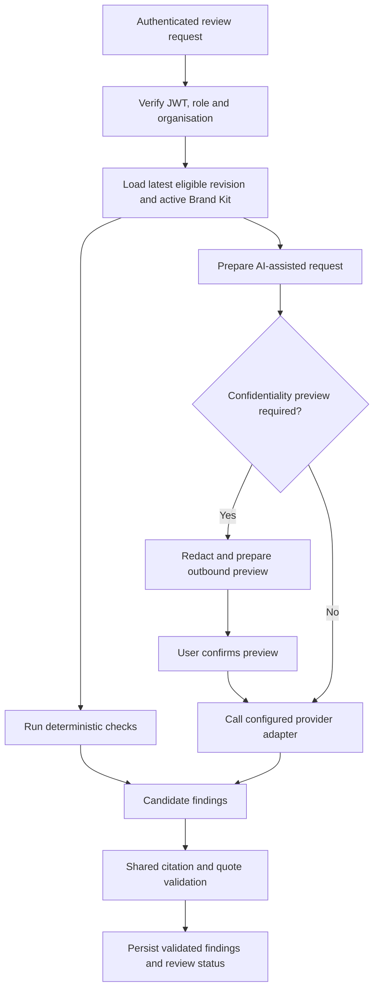

# AnchorDraft — Review Engine

**Document status:** As-built implementation reference  
**Last updated:** 13 November 2026

This document describes the current review-engine responsibilities and provider boundary. It supersedes the original pre-build proposal where the two differ.

## 1. Purpose and invariants

The review engine turns a content revision and its applicable Brand Kit into review findings. The most important invariants are:

1. Findings must reference an applicable rule or approved fact.
2. Quoted evidence and offsets must be validated against the actual revision text.
3. Deterministic and AI-assisted candidates use shared validation before persistence.
4. Model/provider failure must not erase valid deterministic findings.
5. A review result must remain associated with the revision and kit version that were evaluated.
6. Draft text and guideline text are untrusted data, not instructions to the system.
7. Human users retain authority over decisions and approvals.

## 2. Processing flow



The actual route and confirmation sequence is exposed through the versioned FastAPI API. See the route modules and generated OpenAPI document for exact request/response contracts.

## 3. Deterministic checks and finding validation

Deterministic checks evaluate configured rules using the check types supported by the engine. Candidate findings are validated before persistence.

Validation responsibilities include:
- Confirming the referenced rule or approved fact exists in the applicable Brand Kit version.
- Confirming the quoted evidence exists in the evaluated revision.
- Computing offsets on the server rather than trusting model-provided offsets.
- Rejecting malformed, stale, or unsupported candidate findings.
- Keeping review results tied to their source revision and kit version.

The validator is a security and correctness boundary, not merely a formatting step.

## 4. Provider adapters and fallback

The provider factory supports:
- `fake` for local/test only.
- `groq` for Groq.
- `gemini` for Google Gemini.

The primary provider, fallback provider, model identifiers, credentials, and rate limits are runtime configuration. The repository contains defaults and examples, but they do not prove which provider/model is active in a particular deployment.

Fallback behaviour:
- Only classified transient failures (for example rate limits, timeouts, and provider unavailability) are eligible for fallback.
- Authentication/configuration errors and invalid/blocked output are not treated as transient retry conditions.
- The overall request deadline is shared across the primary and fallback attempts.
- A portion of the deadline is reserved for fallback so a hanging primary request cannot consume the entire time budget.
- Gemini-to-Gemini fallback is supported when the configured fallback model differs from the primary model.
- Logs record safe provider/model/error metadata and must not include prompt contents or credentials.

The fake provider is rejected outside local/test environments. A staging/production deployment must configure a real primary provider and credentials for every enabled fallback provider.

## 5. Confidentiality-aware outbound processing

Before supported text content is sent to an external provider:
1. Load the organisation's confidentiality policy.
2. Apply configured redaction to supported sensitive patterns and custom terms.
3. Construct a preview of the redacted outbound payload.
4. Require explicit user confirmation.
5. Process the confirmed redacted payload.
6. Retain only the redacted prompt and payload hash in the preview record.
7. Encrypt the temporary placeholder reverse map using `PREVIEW_ENCRYPTION_KEY` and clear it after terminal processing.

Preview records are short-lived (10 minutes in the implemented design). The encryption key must be stable across engine instances that may process the same preview.

**Image limitation:** attached image bytes are not OCR-redacted by the text redaction pipeline. Explicit creator consent is required before sending images to a vision provider. Do not describe this as full image sanitisation.

## 6. Vision processing

The provider factory includes vision-provider adapters for the supported configured provider types. Vision processing must respect the explicit image consent path. Do not infer OCR redaction or pixel-level brand identity recognition from the existence of image upload or vision support.

## 7. Guideline-gap analytics

The review outcomes can be analysed for recurring dismissal patterns and potential guideline gaps. The analytics path uses evidence thresholds and deterministic reason clustering to avoid treating isolated dismissals as a reliable signal.

Suggested guideline changes remain human-governed:
- Suggestions are organisation-scoped.
- A suitably authorised person reviews the evidence.
- Accept/reject is an explicit decision.
- Accepted changes follow the Brand Kit draft/version lifecycle.
- Suggestion lifecycle actions are auditable.

The feature is decision support. No validated production precision/recall or large-scale benchmark result is claimed.

## 8. Runtime configuration

See `engine/.env.example` and [Engine README](../engine/README.md).

Important variables include:
- `ENVIRONMENT`
- `LLM_PROVIDER`
- `LLM_FALLBACK_PROVIDER`
- `LLM_FALLBACK_ENABLED`
- `GROQ_API_KEY`, `GROQ_MODEL`, `GROQ_VISION_MODEL`
- `GEMINI_API_KEY`, `GEMINI_MODEL`, `GEMINI_FALLBACK_MODEL`
- Provider rate-limit settings
- `PREVIEW_ENCRYPTION_KEY`

Never commit provider credentials. Free-tier provider terms and quotas are account-dependent; use fictional data unless the provider's current terms and the organisation's policy have been reviewed.

## 9. Testing and verification

The final-round backend test suite was recorded as 790 passed and 4 skipped. Provider and orchestration tests cover important fallback, validation, and error-handling paths, but mocked tests do not prove live provider availability or quota.

For the complete local test command, run from `engine/`:

```bash
uv sync --extra test
uv run pytest -v
```

For live provider checks, use a controlled test environment with non-sensitive sample content and valid provider credentials. Do not run provider-spike experiments against production user content.

## 10. Scope boundaries

The review engine does not claim:
- Perfect detection of every brand or editorial violation.
- Pixel-perfect visual comparison or automated logo identity recognition.
- OCR redaction of image bytes.
- Guaranteed privacy across external provider infrastructure.
- Validated model accuracy or benchmark precision/recall.
- Autonomous approval without a human decision.
